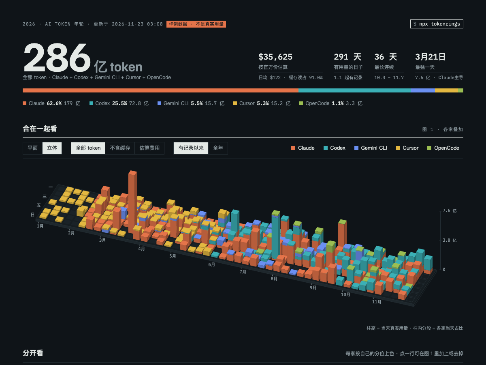

# tokenrings

**One command turns your AI coding token usage into a GitHub-style contribution graph — flat or 3D — as a single HTML file.**

```bash
npx tokenrings
```

Reads local logs from Claude Code, Codex, Gemini CLI / Antigravity, Hermes Agent, Cursor, OpenCode, WorkBuddy, CodeBuddy and 60+ other AI coding tools, then opens `tokenrings-2026.html` in your browser. Nothing is uploaded. Works on macOS, Linux and Windows (Node 18+).

[中文说明](#中文)




*Screenshots use sample data (`npx tokenrings --demo`). [Open the demo page](docs/demo.html).*

## What you get

- **All tools stacked in one grid**: each day's cell is split by how much each tool used that day.
- **Each tool on its own row**, on the same timeline, so you can see when you switched tools.
- **Flat or 3D**: isometric bars on a plinth, height = real usage.
- **Three measures**: total tokens, tokens without cache reads (cache reads are often 90%+ of the total), estimated cost in USD.
- **A local ledger** at `~/.tokenrings/ledger.json`: every run saves each day's totals, so days stay counted after the tools delete their logs.
- **One file, about 50 KB**. Send it to anyone, open it on a phone. Add `#3d` to the file's URL to open straight into the 3D view.
- **No logs yet?** `npx tokenrings --demo` builds the page from sample data.

The page text is in Chinese for now; an English page is planned.

## FAQ

### How do I see my Claude Code token usage as a contribution graph?
Run `npx tokenrings`. It picks up `~/.claude/projects` along with every other tool it finds.

### Why is my older Claude Code usage missing?
Claude Code deletes conversation logs older than 30 days by default, and every usage tool (ccusage, tokscale, tokenviz, this one) reads those same logs. Set `"cleanupPeriodDays": 36500` in `~/.claude/settings.json` to keep them. From your first `tokenrings` run on, daily totals are also kept in the ledger.

### Why do ccusage, tokscale and tokenviz show different numbers for Codex?
Codex writes cumulative counters, and resumed or forked sessions replay earlier events. Tools that add up the cumulative totals count the same tokens several times. On one real machine, the same Codex logs gave 22.1B, 7.7B and 6.1B tokens depending on the method. tokenrings uses tokscale's counting, the most conservative of the three.

### How is this different from ccusage / tokscale / tokenviz?

| | tokenrings | [tokscale](https://github.com/junhoyeo/tokscale) | [ccusage](https://github.com/ryoppippi/ccusage) | [tokenviz](https://github.com/harshkedia177/tokenviz) |
|---|---|---|---|---|
| Output | single HTML file | terminal UI, JSON, website | terminal tables, JSON | terminal, PNG |
| Tools | 60+ (via tokscale) | 60+ | Claude Code, Codex and more | 4 |
| All tools in one graph and per tool | yes | yes | no | yes |
| 3D view offline | yes | on tokscale.ai after submitting | no | no |
| Keeps days after logs are deleted | yes, local ledger | no | no | no |
| Leaderboard, profile embeds | no | yes | no | no |

tokenrings does not parse logs itself; [tokscale](https://github.com/junhoyeo/tokscale) does that. If you want a public profile or a leaderboard, use tokscale.

## Options

```
--year 2026        which year (default: this year)
-o, --out FILE     output path (default ./tokenrings-<year>.html)
--clients a,b      only these sources (tokscale client names)
--from FILE        use an existing `tokscale graph` JSON instead of scanning
--demo             build from sample data, don't read local logs
--no-open          don't open the browser
--no-ledger        don't read or write ~/.tokenrings/ledger.json
```

## 中文

一条命令，把你这一年用 AI 写代码烧掉的 token 画成 GitHub 那种绿格子图（这里叫"年轮"），平面、立体都有，输出一个单文件网页。

```bash
npx tokenrings
```

- 支持 Claude Code、Codex、Gemini CLI / Antigravity、Hermes、Cursor、OpenCode、WorkBuddy、CodeBuddy 等 60 多种工具，自动识别本机装了哪些。
- 数据只在本机，不上传。macOS、Linux、Windows 都能用，需要 Node 18 以上。
- 每次运行会把每天的数存进 `~/.tokenrings/ledger.json`。Claude Code 默认 30 天删日志，有了底账，统计过的日子就不会丢。
- 生成的网页约 50KB，可以直接发给朋友，手机上也能打开。网址末尾加 `#3d` 直接进立体视图。
- 还没装 AI 工具？`npx tokenrings --demo` 用样例数据先看效果。

**Claude Code 早期的用量为什么查不到？** Claude Code 默认只保留 30 天对话日志，所有统计工具读的都是这批日志，删了就找不回。在 `~/.claude/settings.json` 里加 `"cleanupPeriodDays": 36500` 可以避免。

## Development

```bash
npm test          # smoke test; CI runs it on Linux, macOS and Windows with Node 18 and 22
npm run demo      # writes and opens tokenrings-<year>-demo.html
```

`template.html` is the whole page. The CLI inlines the data into it in place of `<script src="data/data.js"></script>`.

## License

MIT. Data layer by [tokscale](https://github.com/junhoyeo/tokscale).
